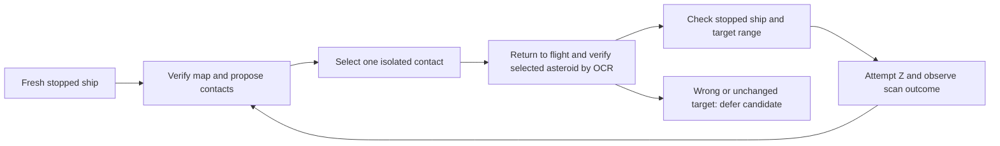

# Asteroid discovery through map selection and HUD verification

Status: map-contact geometry prototype offline verified, October 7, 2026.
Native target acquisition and automatic nearby scanning remain unverified and
disabled in the cockpit. This extends the mining runtime work in response to
the user's request to discover asteroids through OCR or map selection.

## Chosen mechanism

Use the system map to propose contacts, then use target-panel OCR after selection
to establish asteroid type and range. Flight-view silhouettes can be obscured by
the ship or planetoids and move with the camera. OCR sees the selected asteroid
label but does not identify every unselected rock. The retained circular maps
provide discrete hollow contact glyphs that can be located without a learned
object detector. A contact glyph alone does not identify an asteroid or prove
that it is unscanned.

The local mining and ship-control guidance prefers Shift+M, but earlier attempts
produced the circular/3D map or no change. Verify the resulting map rather than
assuming the key chord opened a particular view. Only a single left selection
click belongs to candidate acquisition; right-click orientation, double-click
focus and throttle are separate controls.



## Implemented read-only prototype

`bsgo_offline/map_discovery.py` recognizes the native 2560x1440 map's footer
controls and close triangle before searching its scene region. A bounded
connected-component reader proposes isolated neutral hollow glyphs with a dark
center, supported dimensions and ring contrast. Filled stars, clipping, touching
glyphs and over-budget searches reject instead of producing a truncated list of
apparently valid click targets. An empty result proves neither route clearance
nor completion of a belt sweep. Different window sizes are currently rejected;
the startup HUD-region calibration does not calibrate map markers or grant input.

Each proposal carries native pixel bounds and a center. Object type, scan state,
resource and distance remain unknown. There is no input import, native dispatch,
selection-effect proof or integration into `ScanCatalog` as validated asteroid
evidence. The existing `ScanSweep` requires independently verified unscanned
candidates; map proposals cannot bypass that contract. Nearby scan Start and API
capabilities remain unavailable while their provider and executor are incomplete.

The CLI writes local source-hashed JSON and an annotated image:

```powershell
& tools/model-runtimes/fastvlm-venv/Scripts/python.exe tools/offline-bot/discover_map_contacts.py --image SAVED_NATIVE_MAP.png --output logs/offline-bot/map-discovery-NEW-RUN
```

The output directory must be new. No screenshot capture or game input happens.
Retained overview and recovery maps produced 178 and 164 unclassified proposals.
Those whole-frame counts are exploratory, not fully labeled object counts.

## Evidence and accuracy boundary

The committed corpus contains 67 small manually reviewed native map patches:
35 contact positives and 12 negatives from two development captures, plus 12
positives and eight negatives from an older, different run evaluated with frozen
parameters. The recovery run was inspected while tuning the threshold, so it is
development evidence even though it comes from a second run. Labels describe
visible contact glyphs, never asteroid identity, resources or unscanned state.
Only small map glyphs, footer controls and close-corner crops are committed.
Full source screenshots and annotated full-frame overlays remain local.

| Group | Contact cases | Correct accepted contacts | Wrong accepted contacts | Rejected contact cases | Noncontact cases rejected |
| --- | ---: | ---: | ---: | ---: | ---: |
| Development | 35 | 30 | 0 | 5 | 12/12 |
| Other-run evaluation | 12 | 10 | 0 | 2 | 8/8 |

This measures glyph geometry on curated patches, not completeness or precision
across the entire map. Old screenshots are not prospective native acceptance.
Some contact glyphs and JPEG variants remain unsupported. Reproduce the patches
from available local originals with `prepare_map_evidence.py`; source hashes and
crop coordinates are recorded in the fixture manifest. `evaluate_map_contacts.py`
checks patch hashes and reports correct, wrong and rejected cases separately.
No live capture, selection, scan, flight or gameplay recovery was performed.
The 60 focused detector/catalog/selected-scan checks and all 626 offline tests
passed. Local results are under `logs/offline-bot/map-discovery-20261007/`.

## Remaining execution and acceptance work

1. Acquire a fresh stopped, full-hull flight HUD and exclusive selection/scanner
   ownership. Opening a map hides the speed HUD: a cached pre-map speed cannot
   indefinitely authorize clicks or Z. The executor needs a bounded map-view
   lease, takeover/cancellation checks and a return-to-flight verification before
   scanning. Do not weaken the existing selection probe's fresh-speed guard.
2. Confirm one candidate across newer map captures with stable geometry, zoom,
   center and an independently reviewed mining-area search region. Screen-center
   proximity is not world distance. This prototype does not read Greek rings or
   infer the safe mining zone from pixel position.
3. Deliver one left-click through the owned input executor. Observe the map's
   selection indication, return to flight and require newer matching asteroid
   HUD observations, fresh speed and hull before any Z. An unchanged prior target,
   wrong target class or ambiguous click is a failed acquisition. HP equality
   alone cannot associate a map contact with a world asteroid, and different
   asteroids may share HP; preserve selection-event/marker continuity evidence.
4. Reuse the stationary scan primitive with its configured range guard. Record
   input delivery separately from visible scan effect and resource classification.
   The selected-marker reader supports only measured bright blue/purple scanned
   textures; absence of color does not prove unscanned. Unsupported outcomes stay
   unknown, and an attempted contact is not repeatedly scanned in the same sweep.
5. Reopen/revalidate the map and retire coordinates on camera, map zoom/pan, ship
   movement, context/session, layout or ownership changes. View-local contact IDs
   and a per-sweep attempt list are not permanent world or respawn identities.
6. Collect prospective map-selection/flight-HUD pairs, including ships, wrong
   selections, duplicate HP, overlapping contacts, zoom changes, scene changes,
   range failures and cancellation. Verify that clicks select the intended rock
   without steering, and that every scan attempt has current stopped HUD evidence,
   before exposing a native nearby-scan toggle. New-size acceptance is separate.

The next practical experiment is one stationary map-contact selection followed
by flight-HUD verification. The missing step is this controlled association and
ownership loop, rather than finding every asteroid with generic OCR.
